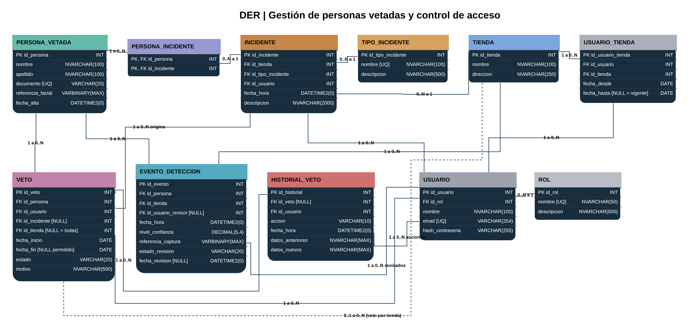

# Sistema de gestión de personas vetadas y control de acceso

Trabajo Práctico Integrador de **Base de Datos II**, Tecnicatura Universitaria en Programación (UTN FRGP), 2026.

## Equipo 03

| Integrante | Legajo |
| --- | --- |
| Baini, Evelyn Rocío | 33494 |
| Gonzalez Trejo, Santiago Agustín | 33056 |
| Soto, Aylen Magali | 35646 |
| Tesaglio, Cristian Ariel | 31821 |

## Descripción

La base de datos da soporte a un sistema que controla el ingreso de personas vetadas a las tiendas de una empresa. Tiene dos partes:

- **Motor de inferencia:** reconoce a las personas que entran a cada tienda, las compara con la base de personas vetadas y, si encuentra coincidencia, registra un evento de detección y genera una alerta.
- **Web de gestión:** permite a los usuarios autorizados registrar incidentes, aplicar y levantar vetos, y revisar las detecciones.

## Decisiones de diseño

- **Alcance del veto.** Un veto puede aplicar a toda la empresa o a una sola tienda. Si `VETO.id_tienda` es `NULL`, el veto vale para todas las tiendas; si tiene valor, solo para esa tienda.
- **Origen del veto.** `VETO.id_incidente` indica qué incidente originó el veto.
- **Vigencia del veto.** Un veto está vigente si su estado es `ACTIVO` y su `fecha_fin` es `NULL` (tiempo indeterminado) o posterior a hoy. Los vetos no se borran: al eliminarlos pasan a `LEVANTADO` (baja lógica).
- **Historial de asignaciones de usuarios a tiendas.** `USUARIO_TIENDA` tiene su propia clave (`id_usuario_tienda`), así un usuario puede ser asignado varias veces a la misma tienda en distintos períodos. `fecha_hasta` en `NULL` indica que la asignación está vigente. Un índice único filtrado impide que el mismo usuario tenga dos asignaciones vigentes a la misma tienda.
- **Auditoría.** `HISTORIAL_VETO` guarda cada alta, baja y modificación de un veto, con los datos anteriores y nuevos en formato JSON.

## Diagrama de entidad-relación

El archivo editable está en [`docs/DER.drawio`](docs/DER.drawio).

## Cómo crear la base de datos

Requiere **SQL Server 2017 o superior**. Ejecutar los scripts de la carpeta `sql/` en este orden:

| Script | Contenido |
| --- | --- |
| `01_creacion_tablas.sql` | Base `BD2_TPI_G03`, tablas, claves, restricciones e índices |
| `02_datos_ejemplo.sql` | Datos de prueba para todos los casos |
| `03_funciones.sql` | Funciones de usuario |
| `04_vistas.sql` | Vistas |
| `05_procedimientos.sql` | Procedimientos almacenados |
| `06_triggers.sql` | Triggers |
| `07_pruebas.sql` | Ejecuciones de prueba (casos de éxito y de error) |

El script `01` borra y vuelve a crear la base, así que se puede correr desde cero las veces que haga falta. Las fechas de los datos de ejemplo se calculan a partir del día en que se ejecuta el script, así los vetos vigentes y vencidos se mantienen sin importar la fecha.

## Datos de ejemplo

| Caso | Dónde está en los datos |
| --- | --- |
| Veto vigente para toda la empresa | Vetos 2, 6, 8, 9, 11 y 12 |
| Veto vigente solo para una tienda | Veto 3 (Centro), 10 (Caballito) y 13 (Belgrano) |
| Veto vencido | Vetos 1, 4 y 7 |
| Veto levantado | Veto 5 |
| Persona reincidente | Julián Acosta (un veto vencido y uno nuevo vigente) |
| Persona con veto ya vigente que vuelve a cometer un incidente | Romina Benítez (incidente 13) |
| Incidente con varias personas | Incidente 3 |
| Detecciones pendientes | Eventos 14, 15, 16, 18, 19 y 20 |
| Detecciones confirmadas | Eventos 1 a 5, 9, 10, 11 y 13 |
| Detecciones descartadas | Eventos 6, 7, 12 y 17 (automático) y 8 (revisión manual) |
| Detección con confianza baja | Eventos 8 y 19 |
| Usuario reasignado a la misma tienda | Carla Gómez en Sucursal Centro |
| Usuario sin acceso vigente a una tienda | Diego Fernández (Centro y Belgrano), Sofía Herrera (San Isidro) |

Todos los usuarios de prueba tienen la contraseña `1234` (guardada como hash SHA-256).

## Objetos de base de datos

| Tipo | Nombre | Responsable |
| --- | --- | --- |
| Función | `fn_veto_vigente` | Santiago Gonzalez Trejo |
| Función | `fn_cantidad_incidentes` | Santiago Gonzalez Trejo |
| Vista | `vw_personas_vetadas_vigentes` | Santiago Gonzalez Trejo |
| Vista | `vw_detecciones_pendientes` | Santiago Gonzalez Trejo |
| Vista | `vw_incidentes_por_tienda` | Santiago Gonzalez Trejo |
| Procedimiento (reporte) | `sp_reporte_detecciones` | Evelyn Baini |
| Procedimiento (acción) | `sp_registrar_incidente` | Evelyn Baini |
| Trigger (INSERT) | Alta de veto con auditoría | Cristian Tesaglio |
| Trigger (INSERT) | Descarte automático de detecciones | Cristian Tesaglio |
| Trigger (DELETE) | Baja lógica de veto | Cristian Tesaglio |
| Trigger (UPDATE) | Auditoría de modificaciones de veto | Cristian Tesaglio |

## Links

- Documento final (PDF): _pendiente_
- Video de demostración: _pendiente_
